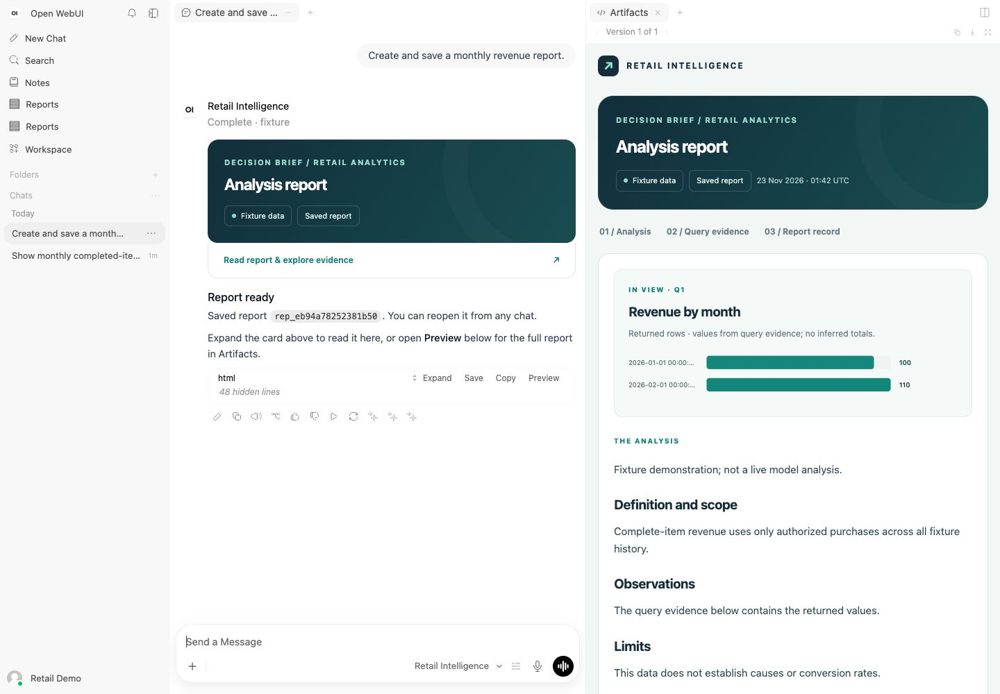

# Retail Intelligence

A retail analysis assistant with Gemini, BigQuery, Open WebUI and a CLI.
Ask a business question, inspect the SQL and save an HTML report.



Synthetic demo · [Quick walkthrough](START_HERE.md) · [Evaluation results](#verification-and-limits)

## Run with your credentials

Requires Docker with Compose v2. Python and uv run inside the containers.

```sh
git clone https://github.com/ottergottaott/retail-text-to-sql.git
cd retail-text-to-sql
cp deployment/live.env.example .env.providers
```

The template uses **Google Gemini directly**; no gateway account is needed.
Edit only these three values in `.env.providers`:

- `GOOGLE_CLOUD_PROJECT`: your BigQuery execution project.
- `GEMINI_API_KEY`: your [Google AI Studio key](https://aistudio.google.com/apikey).
- `GEMINI_MODEL`: a model ID enabled for that key.

Leave `LLM_PROVIDER=gemini`, the prefilled Google `GEMINI_BASE_URL` and
`EMBEDDING_PROVIDER=none` unchanged for the first launch.

BigQuery needs **separate Google credentials**, not the Gemini key. Use an
existing credential JSON, or create one with `gcloud auth application-default login`.
Pass that JSON file to the launcher below. Your execution project needs the
BigQuery API enabled and permission to create query jobs.
[Credentials and permissions checklist](docs/setup.md#credentials-checklist).

```sh
./start.sh --live --project retail-live --env-file .env.providers --google-credentials /absolute/path/google-credentials.json
```

The first build downloads images and dependencies; allow several minutes.
Wait for **Ready (live)**. Open **http://localhost:3000**. Sign in with `WEBUI_ADMIN_EMAIL` and
`WEBUI_ADMIN_PASSWORD` from the generated `.env.docker-retail-live`, then select
**Retail Intelligence**. Ask **Create and save a monthly revenue report.**
Open **Reports**, select the report and expand **Query evidence**.

The backend is at `http://localhost:8000`; its API reference is at `/docs`.
The source dataset is `bigquery-public-data.thelook_ecommerce`. You supply your
own keys and GCP project; model and BigQuery calls may incur charges. Credentials
are excluded from Git and container images. Startup readiness does not verify
cloud permissions or quota: submit a live question to check both integrations.

Rerun the same launch command to resume. Stop with
`./start.sh --stop --project retail-live`; Docker volumes retain data.

[CLI and reviewer walkthrough](START_HERE.md) ·
[Alternative model endpoints and troubleshooting](docs/setup.md)

<details>
<summary>Use an OpenAI-compatible gateway instead</summary>

Set `LLM_PROVIDER=openai_compatible`, `OPENAI_COMPATIBLE_BASE_URL` (usually ending
in `/v1`), `OPENAI_COMPATIBLE_API_KEY` and `OPENAI_COMPATIBLE_MODEL` in the same
file. Google model-key settings are unused on this path. BigQuery still needs
its separate Google credential JSON. Choose an endpoint that speaks the selected
API protocol.

</details>

## Optional fixture preview

`./start.sh` starts a separate synthetic demo without cloud keys. Its rule-based
planner supports examples such as `monthly revenue` and `save report`; this mode
does not test Gemini or BigQuery. Login details are in `.env.docker-retail-demo`.
Stop it before live startup, or choose different ports.

## How it works

The agent makes typed decisions inside a bounded LangGraph workflow. SQLGlot
validates generated SQL against four approved logical tables. The executor binds
those tables to product-scoped BigQuery sources, dry-runs queries and enforces
query, time, byte and result limits. One repair is allowed for repairable SQL errors.
Local PII scanning sanitizes copies before generation and embedding calls,
including retrieved examples; stored Golden Trios remain unchanged.

Golden Trio retrieval supplies question/SQL/report examples using lexical and
vector rankings with RRF fusion. Examples are versioned and filtered by access;
they provide methodology, not current facts. Embedding indexing is explicit.

Reports include evidence, limitations and proposed actions. Grounding review
precedes persistence in live mode. Reports are owner-scoped and checked against
current product permissions. Feedback queues automatic evidence/access/quality checks. Passing examples enter
the original brand/product scope; unsupported corrections are retained without
publication. The CEO can change tone in My preferences: a passing quality gate
activates it automatically, with version history and rollback.

## Verification and limits

Recorded on 23 November 2026. The report-grounding prompt was evaluated with
WikiVibe's `gemini-3.8-flash` gateway alias for both generation and judging.
[Results, protocols and reproduction](evaluation/faithfulness-debug-2026-11-23/README.md).

| Check | Result | Coverage |
| --- | ---: | --- |
| Local regression suite | **308 passed** | [Safety, retrieval, preferences, learning and evaluator checks](evaluation/faithfulness-debug-2026-11-23/regression.xml) |
| Standard Ragas, validation | **0.683 → 0.718** | 20/20 baseline; 20/20 candidate |
| Standard Ragas, reserved test | **0.752** | 20/20 candidate; not used for tuning |
| Custom SQL-aware, validation / test | **0.988 / 1.000** | 20/20 each; separate metric contract |
| Answer tables and structure | **20/20 validation; 20/20 test** | Exact frozen-row checks |
| Automatic learning browser smoke | **5 checks passed** | [Fixture feedback, tone and rollback](evaluation/automatic-learning-browser-2026-11-23.json) |

These are **synthetic report-review evaluations**, with frozen SQL results and
supplied schema as evidence; they do not execute BigQuery or measure end-to-end
SQL accuracy. Standard Ragas 0.4.4 Faithfulness is unchanged. The custom SQL-aware
score is a separate contract. Each run has one repetition; using the same model
for generation and judging can introduce bias. The paired change interval includes
zero, so a statistically reliable gain is not established. Validation was previously exposed;
the reserved test was not used for tuning. Provider failures and bounded rechecks
are retained in the [evidence](evaluation/faithfulness-debug-2026-11-23/final-metrics.json).

[Clean Docker startup](evaluation/client-startup-2026-11-23.json) was checked with
fixture data and synthetic Google credentials. Fresh client Gemini/BigQuery
acceptance and installation on another machine remain unverified. Langfuse is
optional and off by default. The worker supports one API process;
[automatic-learning limits](docs/improvement.md) describe the bounded gates.
Do not enter real PII into WebUI: it stores messages before backend sanitization.

<details>
<summary>Historical measurements</summary>

The older live BigQuery set scored standard Ragas 0.534 and custom SQL-aware
0.843 on 12 reports. Hydrogen scored 0.588 standard on only 4/20 synthetic
validation cases before provider/time limits. Those runs used different
models/prompts or evidence and are not paired controls for this experiment.
[Recorded checks and limitations](docs/review-summary.md).

</details>

## Further reading

- [Architecture and diagram](docs/architecture.md)
- [Requirements and implementation status](docs/acceptance-spec.md)
- [Evaluation evidence](docs/submission-evidence.md)
- [Shared tone and learning workflow](docs/improvement.md)
- [Developer setup](docs/setup.md#host-python-development)
