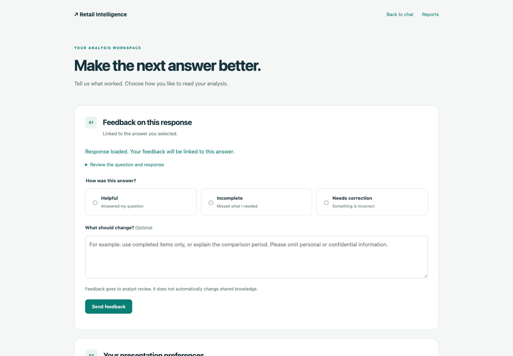
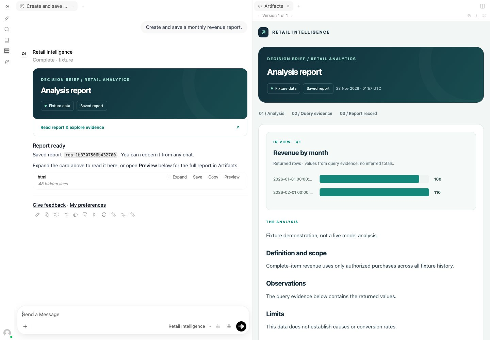
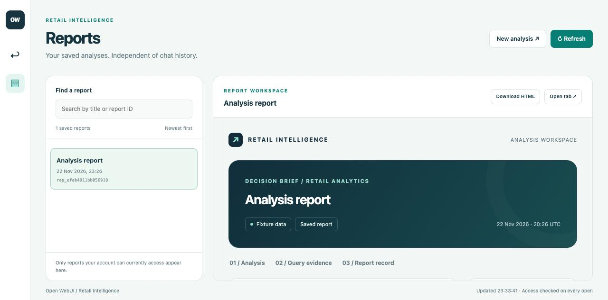
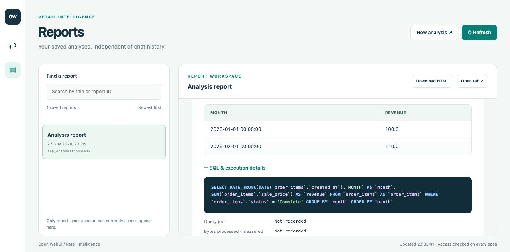

# Reviewer guide

## Start Gemini and BigQuery

Follow [Run with your credentials](README.md#run-with-your-credentials).
The launcher builds the containers, generates local login secrets and installs
the WebUI integrations. You need Docker with Compose v2, your model key and
Google credentials. No host Python installation is required.

Use a fresh WebUI volume for the initial administrator account. If ports are
occupied, append `--api-port 8010 --webui-port 3010` to the launch command.
The selected env file and Google JSON are copied through the Docker API; Google
credentials are stored in a private volume mounted read-only by the API.

## Try the workflow

1. Open `http://localhost:3000`, sign in using `.env.docker-retail-live` and
   select **Retail Intelligence**.
2. Ask **Create and save a monthly revenue report.** Inspect the evidence table,
   limitations and saved report ID.
3. Open **Reports**, select the report, expand **Query evidence** and use
   **Open tab**. The standalone HTML download is a snapshot.
4. In a new chat, ask **List my saved reports.** Reports persist independently
   of their originating chat.
5. Click the **Give feedback** link below a new assistant response.
   Select **Helpful**, **Incomplete** or **Needs correction**
   and optionally add a comment. The form is linked to that specific response.
   Native WebUI thumbs up/down are separate and do not submit this feedback.
   **My preferences** beside it opens your saved format/depth settings.
   Older responses use the **Give feedback** toolbar action.
6. Ask **Delete reports** to preview the targets. Use `/cancel ID` to keep them;
   deletion requires the displayed `/confirm ID` command.

<details>
<summary>Feedback form preview (synthetic demo)</summary>



</details>

The static live demo permissions give Alice Seven7/Calvin Klein, Bob Diesel and
the CEO all brands. Adjust `BRAND_ACCESS_JSON` before launching if needed.
Demographic results require the configured minimum cohort size, including for the CEO.

### WebUI and report screens

Chat and Artifacts, captured 23 November with synthetic fixture data:



The report-library screenshots below were recorded on 22 November with synthetic
fixture data. Your live report titles, rows and IDs will differ.

<details>
<summary>Reports library: select a report, open a tab or download HTML</summary>



</details>

<details>
<summary>Query evidence: returned rows and highlighted SQL</summary>



</details>

## CLI

The CLI uses the same API, permissions and saved reports as WebUI.
Find the token mapped to `alice` in `API_TOKENS_JSON` inside
`.env.docker-retail-live`. Paste it after running `read` below, then press Enter;
input is hidden. The model-provider key is a separate credential.

```sh
read -rs RETAIL_API_TOKEN
export RETAIL_API_TOKEN
docker compose -p retail-live --env-file .env.docker-retail-live exec -e RETAIL_API_TOKEN api retail
```

At `you>`, enter questions such as **Show monthly revenue**, then
**Break it down by brand**, then **Save this report**. The interactive session
retains its conversation. Use `/quit` to exit. Deletion previews use the displayed
`/confirm ID` or `/cancel ID` commands.

For one question with JSON output:

```sh
docker compose -p retail-live --env-file .env.docker-retail-live exec -T -e RETAIL_API_TOKEN api retail --once 'Show monthly revenue' --json
```

Progress and the conversation ID go to stderr; the JSON result goes to stdout.
To continue in a later invocation, copy the returned conversation ID:

```sh
docker compose -p retail-live --env-file .env.docker-retail-live exec -T -e RETAIL_API_TOKEN api retail --conversation CONVERSATION_ID --once 'Break it down by brand' --json
```

## Optional synthetic preview

Run `./start.sh` and use `.env.docker-retail-demo` for the login. This separate
fixture mode uses synthetic data and a rule-based planner; it does not execute
Gemini or BigQuery. It supports the walkthrough's example questions.

Stop a deployment with `./start.sh --stop --project NAME`. Volumes retain data;
`down -v` erases them. Downloaded HTML snapshots cannot be remotely revoked.

## Review the implementation

- [Measured results and remaining checks](docs/review-summary.md)
- [Architecture and diagram](docs/architecture.md)
- [Tool prompt](docs/prompts/system.txt) and [decision schema](docs/prompts/decision.schema.json)
- [Credential setup and provider options](docs/setup.md#credentials-checklist)
- [Requirements and implementation boundaries](docs/acceptance-spec.md)

A fresh installation on another machine and human report acceptance remain
unverified. See the review summary for live versus fixture evidence and current gaps.
