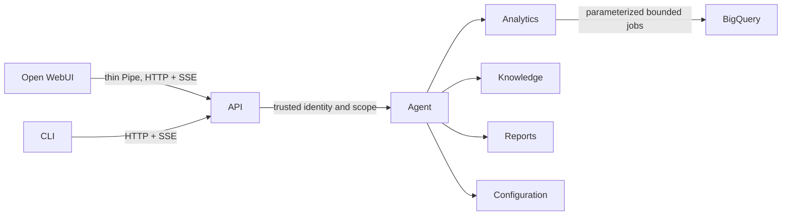

# Production architecture and prototype boundaries

The assignment requires a production HLD covering all eight requirements and a
working prototype for core analysis, safety, destructive oversight, resilience
and observability. CLI and Gemini/BigQuery integration are required. Docker,
Open WebUI and the small learning/retrieval implementations are our additions.
This document distinguishes implemented behavior from proposed production work.
The [consolidated client specification](acceptance-spec.md) records the final
client clarifications, including brand access and automatic preference learning.
See the [detailed interactive diagrams](architecture-details.html) for focused views.

## Components and communication

These are logical responsibilities in one Python backend, not independently
deployed microservices. LangGraph is inside Agent. All access decisions and
storage operations remain backend-owned. Open WebUI runs separately and owns its
UI accounts and chat presentation. Its Pipe forwards one text turn and trusted
server-injected identity/chat IDs, translates SSE progress to status events and
returns final text for WebUI persistence. It runs no second agent or SQL tools.
The required CLI uses the same HTTP endpoints and confirmations.

API resolves a bearer token into a configured backend identity, manager-brand mapping or CEO role. A dedicated WebUI adapter token permits only allowlisted WebUI
identities; an ordinary user token cannot impersonate a forwarded identity. The
prototype uses opaque demo tokens. Production uses verified OIDC subject/audience,
short-lived service authentication and explicit entitlement synchronization.

Agent is a bounded LangGraph state machine: Context → Plan → Tool → Plan, ending
in Clarification, deterministic tool output, or Draft → Review → Answer. Live analytical
answers undergo one grounding revision against original query evidence before
last-analysis state and deferred report saves are committed. The reviewer shares
the turn's time, call and context budgets; an invalid answer or failure saves no
completed draft. `DEEPINFRA_REVIEW_MODEL` can select a stronger Gemini for this
step while planning stays on Flash; empty reuses the planning model. There is no
provider/model fallback on review failure. This is an LLM quality check, not a correctness or security proof.
Context loads authorized history, preferences,
published persona and permitted relevant trios once per turn. Plan is a structured
Gemini decision. Tools validate typed arguments and execute policy in trusted
code. Schema and report-management tools can terminate with deterministic output.
Deletion confirmation is an application command, never a model-generated action.
State is invocation-local; persisted conversations support follow-ups and restart.
There is no LangGraph durable mid-turn checkpoint/resume in this prototype.

## Compute, cloud and deployment

Local Docker Compose specifies a nonroot Python API container, PostgreSQL and
Open WebUI slim. API port 8000 and WebUI port 3000 bind to loopback; PostgreSQL
has no host port. Named volumes preserve application logs, application database
and WebUI state. Gemini and BigQuery remain external services. No local LLM or
BigQuery emulator is required. SQLite + DuckDB fixtures allow offline development.
Image build/start, PostgreSQL report persistence after API recreation and the
actual WebUI fixture workflow are verified. See [runtime evidence](../evaluation/container-runtime.md).

For production, choose GCP to keep BigQuery execution, identities and operations
in one environment. Deploy the API/Agent container on Cloud Run behind HTTPS and
OIDC enforcement, with request timeout above the configured 90-second turn limit
and bounded concurrency. Open WebUI is a separate Cloud Run service with shared
SQL-backed state and, when scaling its websocket layer, the supported shared
coordination configuration. Store attachments in supported object storage or
disable attachments. Do not rely on a Cloud Run writable filesystem for reports.

Use Cloud SQL PostgreSQL with private connectivity, managed backups/PITR, separate
application and WebUI databases and least-privilege roles. Put curated immutable
trios, review datasets and release manifests in versioned Cloud Storage; maintain
searchable metadata and vector indexes in PostgreSQL. Use Secret Manager and
workload identity. Send structured events to Cloud Logging and optionally
Langfuse. Exact instance sizes, region and retention are deployment decisions
requiring load and data-residency requirements; no sizing result is claimed.

The current API has one process with per-conversation locks and four execution
threads. Before multiple replicas/workers, replace process-local serialization
with PostgreSQL advisory locking or a durable per-conversation queue, bound
pending admission, add idempotency keys for saves and handle branch/regeneration
semantics explicitly. Extend long analysis with asynchronous jobs and resumable
progress rather than extending HTTP budgets indefinitely. Cloud Tasks/worker
compute is a later option; it is not needed for the bounded MVP request path.

## Storage and lifecycle

| Data | Prototype | Production |
| --- | --- | --- |
| Raw transactions | External public BigQuery dataset | Private governed BigQuery datasets |
| Conversations and latest completed analysis | Owned records in SQL, last 20 turns | Owned normalized tables with retention and deletion policy |
| Saved reports | Independent owned records: title, body, product scope, provenance | Same ownership/lifecycle, indexes and explicit retention |
| Deletion proposals | Exact ID→version map, owner, conversation, 10-minute expiry | Transactional proposal/audit tables, retention for minimal audit |
| Preferences | Per-user format/depth/source/version | Explicit overrides, automatically applied inferred preferences, reset/retention |
| Golden trios | Labeled synthetic seeds and reviewed SQL records | Versioned object source plus SQL metadata/index publication manifest |
| Embeddings | Model/content/version-keyed SQL records | pgvector index when corpus size warrants it |
| Persona | Append-only tone versions in SQL | Editor RBAC, preview, publication and rollback audit |
| Feedback, candidates and evaluations | SQL records linked to turn/reviewer | Restricted review workspace, held-out gates and release history |
| Telemetry | Metadata-only JSONL, optional Langfuse | Restricted centralized logs/traces with retention |

Reports survive UI-chat deletion and can be listed/opened from another chat.
WebUI chat history and backend history are separate stores; deleting a UI chat
currently does not synchronize backend conversation deletion. The production
policy must expose that distinction and implement coordinated deletion/retention.
Deleting a saved report removes its report-library record; its text can remain in
prior chat messages or a previously saved copy. The confirmation must describe
the selected operation, not promise erasure of every copy. Backups and audit
retention also require an explicit policy.

## 1. Hybrid intelligence and Golden Knowledge

Knowledge stores Question → SQL → Analyst Report plus tags, schema version,
publication version, scope and origin. The included seeds are synthetic examples,
not claimed historical analyst work. The report teaches analytical method:
definitions, useful breakdowns, pitfalls and limits on causal interpretation.
SQL results provide current evidence; example report numbers are not current data.

At request time select the latest published version per semantic ID, then filter
compatible schema and authorized scope before ranking. Lexical matching includes
question/report terms and metric/dimension tags. Semantic retrieval embeds the
sanitized question and compares it with precomputed document vectors. Combine
rankings with reciprocal rank fusion, `sum(1/(60 + rank))`, and return at most two
trios. Reject low-similarity semantic candidates. The default cosine threshold
0.65 is an uncalibrated starting assumption, not a measured quality guarantee.
Small-corpus exact scans keep the MVP simple; use pgvector for a larger corpus.

An operator explicitly indexes published documents with
`retail-admin index`. Cache identity includes model, source content and version;
changed records cannot silently reuse stale vectors. Missing indexes or embedding
failure fall back to lexical retrieval and record retrieval_mode. Embeddings and
rank fusion are implemented; semantic quality on the real provider is unverified.
Do not interpret controlled-vector tests as proof of Gemini retrieval relevance.
Retrieved text is untrusted context and cannot authorize tools or change policy.

Update sources through feedback triage, sanitization, analyst review, schema/SQL
validation, held-out evaluation and approved version publication. An index build
follows publication. Production publishes source/index manifest atomically and
can restore a previous approved release. The small implementation evaluates
reviewer-authored SQL result cases and retains candidate/evaluation/version links;
its full production regression gate is still a design commitment. In production,
low-risk candidates passing deterministic security, held-out SQL intent, retrieval
and report-quality gates publish automatically with provenance. Human review is
an exception path for uncertain/high-risk updates, not a required step for every
example. Rollout monitors regressions and can restore the prior version.

## 2. Safety, privacy and product authorization

Policy is enforced before SQL execution and before model context. The model sees
logical schema only. Analytics rejects scripts, writes, qualified physical names,
unknown relations/columns, table functions and unapproved functions; resolves
CTEs/aliases/nested scopes; then replaces every resolved physical source with a
trusted relation. Parameterized brand predicates select all products of permitted
brands; the CEO role permits all brands. Order items use these product relations,
and orders/users require existence of authorized items. Static product-ID
entitlements remain a compatibility path for historical tests/deployments. It
projects only approved columns, with pseudonymous keys instead of raw IDs.
There is no arbitrary appended WHERE clause and SQLGlot is not the identity or
entitlement authority. The trusted executor resolves those independently.

The approved users schema exposes state, country and age band. Names, contacts,
street address, IP, precise coordinates and raw user identifiers are absent.
Order totals are omitted because mixed-product orders could reveal unauthorized
sales. Customer-level outputs concern authorized purchases only. Rotating the
label secret changes labels; persistent customer comparisons must account for it.
Pseudonymization is not anonymity and broad demographics can still identify small
groups. A documented demo policy permits pseudonymous analysis; production needs
additional production privacy controls. The prototype enforces a configurable
minimum of five distinct customers for every released demographic group.
Demographic SQL is restricted to a flat grouped SELECT with validated key joins;
individual demographic rows, nested/window/union queries, disconnected joins
and identifier grouping fail closed. A trusted HAVING guard is added before
execution and limiting. One demographic query is allowed per answer, without
separate totals; prior history/analysis is removed from subsequent model context.
Repeated-question inference needs production query auditing/complementary
suppression or stronger privacy controls; it is explicitly outside prototype scope.

User input is sanitized before backend model/storage. Source projection is the
primary PII control; email/phone/IP detection additionally checks generated fields,
results and saved content. These regex checks do not recognize all names or PII.
Telemetry never records raw exception messages, credentials, prompts or result
rows. Metadata hashes support comparison without exporting those contents.
WebUI stores original input before the backend: production must add ingress
privacy controls and coordinated retention; use no real PII in this demo.

History and latest analysis carry product scope. On each turn, exclude history
whose scope is no longer allowed, and refuse to save analysis produced under
revoked access. Reports are rechecked against current entitlements on list/open
and deletion. Unknown legacy history without scope fails closed.

For private production data, additionally deny raw dataset access to the normal
execution identity and use governed authorized views/row policies with an
appropriate trusted user/scope identity model. A shared service identity does
not make SESSION_USER equivalent to the executive. Public thelook data cannot
provide the same IAM confidentiality boundary: the application executor is the
demo's control boundary. Test generated physical bindings and database policy
separately; neither prompt instructions nor static SQL checks alone are RBAC.

## 3. Strict destructive oversight

Resolve natural-language selection to owned reports using a content substring,
explicit IDs or current conversation scope. Preview exact titles/IDs. Store the
proposal owner, conversation, selected versions, expiry and pending status.
`/confirm ID` or the dedicated confirmation endpoint supplies the user's explicit
choice. A model cannot execute confirmation. The HTTP endpoint requires an actual
JSON boolean. Cancellation is supported and a no-match selection creates no work.

Inside one SQL transaction, lock/claim the pending proposal, validate conversation
and expiry, recheck ownership/product scope/target versions, delete only those IDs,
then record proposal outcome and minimal audit. Replays delete nothing further;
target changes require a new preview. The confirmation survives restart. Network
disconnect does not undo a committed mutation; clients must inspect state before
retrying. Saved-report idempotency keys are pending production hardening.

## 4. Continuous improvement

User-level personalization is separate from shared model/knowledge improvement.
Explicit format/depth choices persist by user, are loaded into each plan and
control deterministic evidence formatting. A one-turn override should not change
the default unless requested. Inferred preferences take effect automatically,
as confirmed by Roi. The design records evidence/confidence and allows inspection,
explicit override and reset; automatic inference is not implemented in the MVP. Do not claim that
storing an explicit preference is autonomous learning of behavior.

System-level feedback references an owned trace/conversation and remains
unreviewed. An operator creates a sanitized candidate and runs independently
authored expected-row cases. Failed cases block publication; passing cases plus
reviewer produce a version and evaluation provenance. Tests demonstrate that a
new approved example changes retrieval while failed reviews do not. This is a
reviewed knowledge improvement loop, not fine-tuning or autonomous self-modifying
instructions. Production additionally requires held-out retrieval/report/safety
gates, staged rollout, alerts and rollback. See [workflow](improvement.md).

## 5. Resilience and controlled cost

Defaults: at most 7 model decisions, 4 query attempts, 100 returned rows,
100 MB maximum bytes billed per BigQuery query, a 64 KB serialized result budget
per query, an 80,000-character model context budget and a 90-second turn budget.
Whole recent history turns are included only while they fit their context share;
an oversized context stops before another model call. If requested, saving a new
report is deferred until a completed safe answer with query provenance exists,
allowing generation and save in one turn without inventing report content.
One SQL repair is permitted after a sanitized resolution/syntax diagnostic.
Policy denials and external dependency failures stop without an access workaround.
Known sensitive SQL fields are denied before schema resolution, so they do not
enter repair. Local DuckDB fixture execution uses a remaining-budget interruption
timer; an expired query is terminal. An analytical answer requires current query
evidence or an authorized persisted previous analysis; a model answer with neither
is withheld and traced as MissingQueryEvidence. This guard checks presence and
scope of evidence, not whether every generated numeric claim is correct.
Empty rows return to planning so the agent can inspect filters or explain valid
absence; it cannot silently widen authorized scope or infer zero from missing data.
Model calls and queries are counted even when repair is needed.

BigQuery dry-run estimates enforce the byte threshold before execution; the
executed job also has maximum_bytes_billed and a server job timeout. SDK implicit
job/request retries are disabled so they cannot bypass orchestration budgets.
The executor recomputes remaining timeout for dry-run, submission and result wait,
and attempts cancellation on failure. GenAI calls use one bounded SDK attempt.
Cancellation and telemetry cleanup can add small overhead; this is not a proven
hard wall-clock deadline. Distributed admission, rate limiting and durable job
reconciliation are production work.

If Gemini fails, respond that no result was inferred. If BigQuery is unavailable,
do not replace it with fixtures or cached numbers presented as current. If vector
search fails, lexical retrieval is allowed and labeled in trace. If Langfuse or
the progress emitter fails, preserve the core result and use local metadata logs.
If storage fails, avoid claiming success; tell the user to check saved state
before retrying a mutation. No raw provider diagnostics reach the user.

## 6. Quality assurance and UX evaluation

Use deterministic tests for authorization, source binding, safe projections,
report ownership/confirmation, revoked scope, input sanitization, budgets and
error categories. SDK mocks verify parameters and retry settings only. Use
reviewer-authored fixture SQL oracles for analytical grain, statuses, complete
periods and authorized scope. Do not use SQL string equality as the sole oracle:
equivalent queries can produce the same required result.

Maintain a held-out intent set covering customer behavior, product comparison,
time metrics, schema help, ambiguity, follow-ups, multi-step reports, empty results
and adversarial input. Real-model evaluation checks executed results against
oracles and separately reviews definitions, findings, grounded numbers, caveats
and action items. LLM judging is advisory and calibrated against human review.
Security regressions are release blockers, not averaged into a quality score.

Retrieval evaluation has question → relevant-trio labels including paraphrases,
exact metric names, negatives, scoped records and schema changes. Report Recall@2,
MRR and irrelevant-example rate, compare lexical/vector/hybrid ablations, tune
thresholds on development cases and hold back the final evaluation set. Test
retrieval changes separately from generation, then test their combined effect.
No semantic benchmark score is currently claimed.

Executive UX tasks: ask an underspending comparison, clarify an undefined churn
cohort, request a report/action items, retrieve it in a fresh chat, cancel and
confirm deletion, and recover from downtime. Observe completion without help,
clarification burden, time to useful answer, understanding of progress/errors,
and accidental destructive actions. Test in CLI and actual WebUI; controlled
Pipe tests are not browser or human UX evaluation. Record participant context
and failures instead of fabricating a satisfaction score. See [evaluation](evaluation.md).

## 7. Observability and debugging

Each backend turn uses one trace_id/request_id/turn_id plus conversation_id,
model-call and tool-call IDs, logical query ID, live BigQuery job ID, model/config/
schema/persona/preference/trio versions, timing, retries and sanitized outcomes.
These IDs intentionally share one request root for the synchronous MVP; a future
queued request may contain multiple attempts/turns and should allocate separate
IDs. Store complete sanitized user/assistant correspondence in owned conversation
records. Context digests and version references locate what informed the model;
telemetry does not export raw context. Reviewers access sensitive records through
separate authorized tooling, not a public trace endpoint.

Track terminal outcomes by mode/version: succeeded, clarification, denied,
budget_exhausted, dependency_error, query_error and internal failure. Track p50/
p95 turn/model/query duration, repair attempts/success, empty/truncated results,
bytes billed/processed, embedding fallback/index coverage, deletion cancellations/
confirmations/replays, report save failures, and available measured token usage.
Keep dry-run byte estimates and any price-derived cost estimates separate from
measured tokens/processed bytes. The MVP does not claim measured monetary cost.

Suggested initial alerts: internal/dependency failure rate >5% over 15 minutes
with at least 20 turns, p95 turn time >60 seconds, unexpected budget exhaustion,
missing telemetry, excessive embedding fallback, and any confirmed cross-owner
or PII incident. These are proposed thresholds requiring calibration. Denied
requests are separate from reliability failures. Protect logs with operator RBAC;
propose 14-day metadata retention and shorter sensitive debug capture, subject
to actual policy. Never enable default raw Langfuse prompt/result capture.

## 8. Persona agility

Persona is versioned presentation data in SQL. An operator publishes a tone file
through `retail-admin persona`; next-turn reads apply it without redeployment,
and traces record the version. Republish a prior tone as a new version to roll
back. Policy and tool code remain outside persona. Tests verify refresh without
recreating Agent. The nondeveloper production editor needs authenticated editor
RBAC, constrained tone/style fields, sample-report preview, publish/rollback and
audit. A submitted tone passes an automated gate, without manual approval:
fixed reference reports must preserve facts, obey privacy/security constraints
and follow the requested style. A failed or incomplete gate keeps the current
version; a passing gate activates a new version with rollback. These gate criteria
are engineering defaults accepted for specification by client delegation. The
operator CLI bypasses that proposed production gate and is not claimed to be
the finished CEO-facing editor.

## Framework/model rationale and experience statement

LangGraph gives explicit state/transitions, bounded tool loops and injectable
models/data tools. The MVP uses a small graph instead of nested free-form agents;
this makes denial, repair and stopping behavior inspectable. FastAPI provides
typed HTTP/SSE interfaces shared by both clients. SQLAlchemy supports local
SQLite and shared PostgreSQL. SQLGlot resolves logical SQL scopes before trusted
source substitution. Gemini is required for evaluator compatibility; configure
an available model explicitly rather than silently substituting another provider.
Actual answer quality/latency/cost must be measured with that chosen model.

This artifact does not assert the candidate's personal production experience
with any framework. Before submission, the candidate must supply an honest
experience paragraph distinguishing previous professional use from learning and
implementation during this assignment. Do not infer personal experience from
generated code, tests or this architecture.

## Extension points

Add tools through typed Agent decisions and backend policy, preserving budgets,
trace IDs and data scope. Chart tools return a validated chart specification from
approved evidence, rendered by a trusted UI component. Email tools use approved
destinations and require preview/confirmation before sending. External trend
search is separately permissioned, cited and treated as untrusted context, never
proof of causes in sales data. Background jobs and signed report download links
can be added without moving business logic into the Pipe.

## Remaining release evidence

Docker build/start, PostgreSQL report persistence after API recreation, container
CLI and pinned Open WebUI chat/progress/table/report saving have been verified
locally in fixture mode. Live Gemini decisions, real embedding relevance and
representative BigQuery jobs remain unverified. Credentials are intentionally
deferred at the user's request. Fixture evidence does not close those provider
gates. No external publication
has been performed or authorized.
