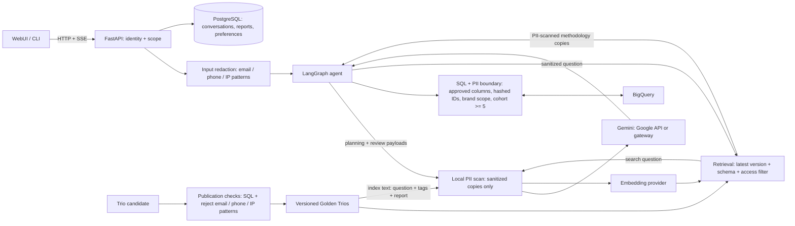

# Architecture

One Python backend serves Open WebUI and the CLI. The backend owns authorization,
SQL execution and report persistence; clients send requests and display progress.

## Request path

1. Resolve identity and brand scope; sanitize input and load permitted context.
2. Retrieve relevant Question → SQL → Report examples as methodology. Scan outgoing
   embedding text and retrieved copies locally; keep stored Trios unchanged.
3. Scan the complete planning/review payload locally, then ask the model for a
   typed decision; validate and dispatch it in trusted code.
4. Validate SQL, bind authorized sources, dry-run BigQuery and execute within budgets.
   Allow one repair for a repairable SQL error.
5. Review the draft against query evidence, then return the answer and save if requested.

## Safety boundaries

- Managers analyze their brands; the CEO sees all brands. Source binding enforces scope.
- Database identifiers such as names, email, street address, postal code, exact coordinates
  and IP address are excluded from approved analytical sources before model context.
  Customer keys are hashed pseudonyms;
  demographics are aggregate-only with a configurable minimum cohort (default 5).
- SQLGlot validates the AST, approved tables and functions. Execution is read-only,
  with query, byte, row, time and model-call limits.
- Saved reports are owner-scoped and checked against current access. Deletion requires
  an explicit user confirmation command after a preview.
- Golden Trio publication rejects email/phone/IP patterns and validates SQL.
  Retrieval filters latest published examples by schema and access, then sanitizes
  copies, including question, SQL and report. The same local scan protects document
  and query embeddings, planning, history, tool results and grounding review.
  Stored fields and original values are retained; they are not sent unchanged.
- The outbound scan combines local English PERSON NER with field/pattern rules
  for names, contacts, street addresses, postal codes, exact coordinates, IPv4/IPv6
  and raw customer IDs. Customer pseudonyms use keyed HMAC. Aggregate geography
  is retained; SQL cohort/privacy rules remain a separate enforcement boundary.
  Detector failure blocks the call. Embedding keys include the privacy policy
  version and sanitized document, preventing reuse of the previous raw-text index.

## State and deployment

Docker Compose runs the API, PostgreSQL and Open WebUI. Gemini and BigQuery are
external; reviewers provide their endpoint, model key and Google credentials.
Conversations, saved reports, preferences and versioned knowledge persist in SQL.
The synthetic offline mode uses SQLite/DuckDB. Langfuse is optional and off by default.

## Current limits

Schema metadata is a static four-table contract. Bounded personal preference
learning has focused local test coverage; live acceptance remains pending. Automatic shared
knowledge/tone promotion remains design work; publication uses operator review.
Conversations persist, but mid-turn recovery does not.
Local NER and pattern rules can miss PII or mask non-sensitive text; this is not
a complete detector for arbitrary prose, languages or address formats.
WebUI stores original messages before backend sanitization: do not submit real PII.
Current brand/privacy changes still require live acceptance with client credentials.

[Visual overview](architecture.html) · [Full technical design](architecture-design.md) ·
[Detailed diagrams](architecture-details.html) · [Requirements](acceptance-spec.md) ·
[Measured results](review-summary.md)

### Privacy coverage and remaining gap

Trusted database projections exclude first/last names, email, street address,
postal code, exact coordinates and IP addresses before query results reach an
LLM. Pseudonymous customer keys are permitted. Demographic results require grouped
aggregates and at least `MINIMUM_COHORT_SIZE` distinct customers (default 5);
individual demographic listings and demographic-filtered customer rankings are
blocked. City, gender and traffic source are currently unavailable in the logical
schema, so they cannot be queried; state, country and age bands are supported.

Outbound protection now scans local copies using the packaged English spaCy
PERSON model and explicit field/pattern recognizers. It runs before embeddings
and generation, including after retrieval of legacy Trios. The model is installed
at build time; there is no runtime download or external detection call. Detector
failure prevents egress. Stored originals and Trio structure remain unchanged.

NER is probabilistic. Unlabelled postal codes, unusual addresses, obfuscated PII
and unsupported languages may evade recognition; names can also be overmasked.
Individual demographic narratives in imported free text do not have the same
provable cohort enforcement as executable SQL. WebUI and the database retain
original text, so access and retention controls still matter. These local checks
do **not** prove that arbitrary user-supplied PII can never reach a model. Do not
submit real PII; production requires broader labelled detection/recall acceptance.

[Detector package and model installation](https://spacy.io/usage/models)
