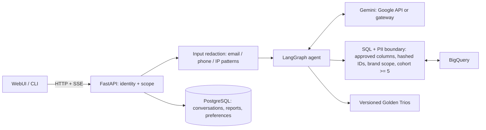

# Architecture

One Python backend serves Open WebUI and the CLI. The backend owns authorization,
SQL execution and report persistence; clients send requests and display progress.

## Request path

1. Resolve identity and brand scope; sanitize input and load permitted context.
2. Retrieve relevant Question → SQL → Report examples as methodology.
3. Ask the model for a typed decision; validate and dispatch it in trusted code.
4. Validate SQL, bind authorized sources, dry-run BigQuery and execute within budgets.
   Allow one repair for a repairable SQL error.
5. Review the draft against query evidence, then return the answer and save if requested.

## Safety boundaries

- Managers analyze their brands; the CEO sees all brands. Source binding enforces scope.
- Database identifiers such as names, email, street address, postal code, exact coordinates
  and IP address are excluded from approved analytical sources before model context.
  Customer keys are hashed pseudonyms;
  demographics are aggregate-only with a configurable minimum cohort (default 5).
- SQLGlot validates the AST, approved tables and functions. Execution is read-only,
  with query, byte, row, time and model-call limits.
- Saved reports are owner-scoped and checked against current access. Deletion requires
  an explicit user confirmation command after a preview.

## State and deployment

Docker Compose runs the API, PostgreSQL and Open WebUI. Gemini and BigQuery are
external; reviewers provide their endpoint, model key and Google credentials.
Conversations, saved reports, preferences and versioned knowledge persist in SQL.
The synthetic offline mode uses SQLite/DuckDB. Langfuse is optional and off by default.

## Current limits

Schema metadata is a static four-table contract. Automatic preference learning and
automatic knowledge/tone promotion are documented production designs; the prototype
uses operator review. Conversations persist, but mid-turn recovery does not.
Input redaction detects email/phone/IP patterns; it is not a complete PII detector.
WebUI stores original messages before backend sanitization: do not submit real PII.
Current brand/privacy changes still require live acceptance with client credentials.

[Visual overview](architecture.html) · [Full technical design](architecture-design.md) ·
[Detailed diagrams](architecture-details.html) · [Requirements](acceptance-spec.md) ·
[Measured results](review-summary.md)

### Privacy coverage and remaining gap

Trusted database projections exclude first/last names, email, street address,
postal code, exact coordinates and IP addresses before query results reach an
LLM. Pseudonymous customer keys are permitted. Demographic results require grouped
aggregates and at least `MINIMUM_COHORT_SIZE` distinct customers (default 5);
individual demographic listings and demographic-filtered customer rankings are
blocked. City, gender and traffic source are currently unavailable in the logical
schema, so they cannot be queried; state, country and age bands are supported.

Free-text input protection is incomplete: the input filter handles email,
international phone and IPv4 patterns, but does not reliably detect names,
addresses, postal codes, coordinates or every identifier embedded in prose.
WebUI also stores original messages before backend sanitization. Consequently,
the prototype does **not** establish an end-to-end guarantee that arbitrary
user-supplied PII never reaches a model. Do not submit real PII. Stronger
pre-model detection/refusal and corresponding boundary tests remain open.
