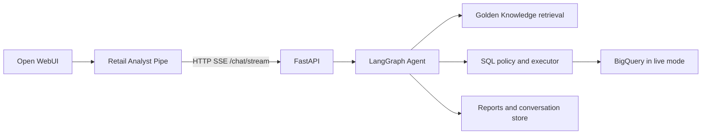

# Open WebUI integration and next live check

Current HTML Artifact and embedded report experience:
[interactive reports](report-experience.md). The historical checks below are
retained; see [final acceptance](final-acceptance.md) for current live readiness.

## Existing connection



The Pipe is implemented in `integrations/openwebui_pipe.py`. It forwards only
the latest question and authenticated server-injected user/chat identity. The
backend owns LangGraph, retrieval, SQL authorization, preference context, report
persistence, confirmed deletion and telemetry. Open WebUI renders progress
statuses and final Markdown tables; no second agent or frontend retrieval index
is required. No separate reports screen is needed for the MVP. New chats can
list/open backend reports independently of a deleted WebUI chat. Deleting a
WebUI chat currently does not delete backend conversations or reports.

## Setup and knowledge indexing

Follow [setup](setup.md) for the pinned Compose stack, administrator Pipe import,
API_URL=http://api:8000, protected ADAPTER_SECRET and WEBUI_USERS_JSON mapping.
These are server settings, not browser credentials. Keep LangGraph tools in the
backend; the Pipe only translates HTTP SSE to WebUI status/result events.

Provider configuration and published knowledge must target the **same backend
environment and database**. A host `retail-admin` may target local SQLite while
Compose uses PostgreSQL; do not index one and expect results from the other.
Inside the configured Compose API service:

```sh
docker compose exec api retail-admin load-demo
docker compose exec api retail-admin index
```

Use the same --env-file / --project-name options as the running stack. For fixture
setup see `.env.fixture` instructions; for live mode first satisfy its startup
checks. Import is explicit and preserves existing publications. Indexing calls
the configured embedding provider and may incur cost. Reindex after changing
provider/model/dimensions/instruction. Evaluation's temporary indexes are never
the application's index. In fixture mode the runtime deliberately uses lexical
retrieval even if embeddings have been indexed.

## Evidence and remaining gate

The current integrated test runs the actual Pipe, FastAPI, LangGraph, fixture SQL
and persistent SQLite using an ASGI transport. It verifies retrieval progress,
terminal status, report save/list/open across chats and cross-user denial.
The local HTTP/CLI scenario separately passes22 checks, including restart,
confirmation, cancellation and replay. These prove backend/adapter integration;
they do not prove browser rendering or current Docker/PostgreSQL operation.
Earlier fixture browser/container evidence is recorded in setup.md. Docker's
daemon is unavailable in the current2026-11-21 session, so it was not repeated.

DeepInfra Gemini chat and Qwen embeddings were verified with real API calls.
The live app still requires a BigQuery execution project, ADC inside the API
container, a dedicated label secret and replacement demo tokens. Host Google
credentials are not automatically mounted; use the read-only override described
in setup.md. Updated readiness after user consent: project `static-bee-277223` and host ADC
are configured; live queries across all four tables passed. The host app default
mode is still fixture; the live verification uses explicit isolated settings. Direct Google API and
Langfuse are separate unverified paths.

After those inputs and Docker are ready, verify one live browser question,
retrieval progress, actual query job/bytes, a saved report opened from a new chat
and deletion preview/cancel/confirm. Keep live BigQuery evidence separate from
the real-model/fixture-data ablation. WebUI persists original messages before
backend PII cleanup; real personal data requires ingress/retention controls.

Future separate reports/charts pages can use the existing owner-scoped report
API. This is an extension point, not a required replacement of the current UI.


## Final acceptance runtime update

The host live backend now persists 12 independently verified business reports on
port 8001 using `.env.live`. The Pipe was installed and its server-side API_URL
set to `http://host.docker.internal:8001`; container-to-host health succeeded.
Subsequent Docker VM disk I/O errors blocked the browser acceptance run. Earlier
fixture browser results do not establish this live UI path. No destructive Docker
recovery was attempted. Host API/SSE, hybrid retrieval, dialogue, isolation,
confirmed deletion and real backend restart were verified separately. Read the
[final acceptance guide](final-acceptance.md) before making a readiness claim.
